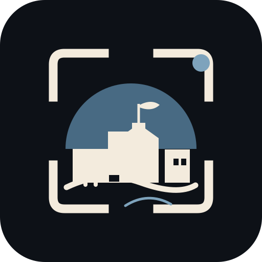
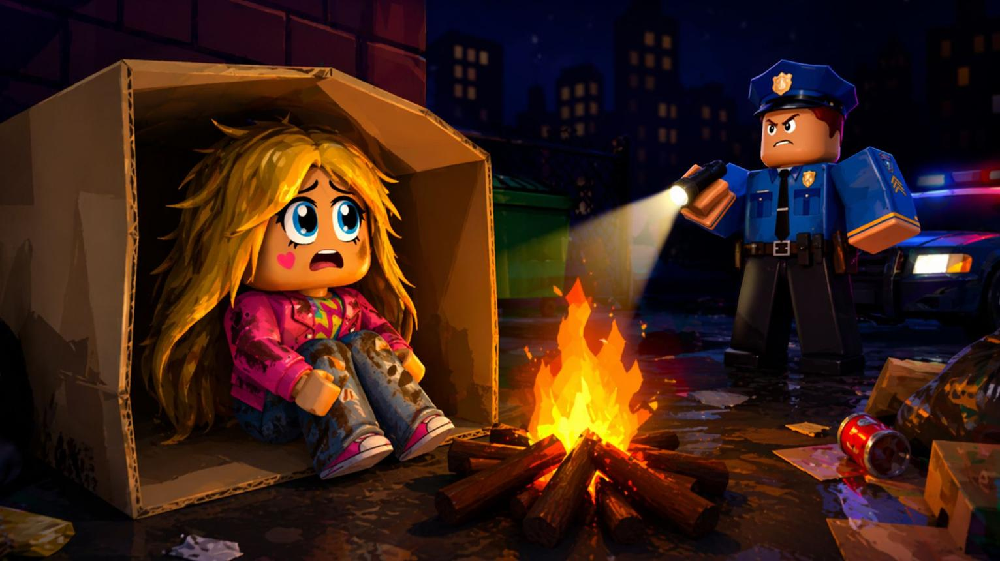

<div align="center">



# Roblox Town Cinematic Studio

**A production director for cinematic Roblox stories.**

An open-source Agent Skill for developing stories, directing scenes, and coordinating the production workflow.

[](CHANGELOG.md)
[](LICENSE)

Created and maintained by **RITVIK** · [Brand guide](assets/brand/brand-guide.md)

</div>

<p align="center">
  
</p>

## What it does

**Roblox Town Cinematic Studio** is built around one canonical Agent Skill: `roblox-town-director`.

It helps an AI assistant take a Roblox story from an initial idea through scripting, visual direction, shot planning, production coordination, editing, and review. It brings the creative and technical parts of that process into one structured workflow.

It is not a Roblox capture application or a standalone video editor. Actual execution depends on the models, software, hardware, and permissions available to the assistant.

## Install

Install the skill with the [Skills CLI](integrations/agent-skills-cli.md):

```bash
npx skills add lowlevelbtw/roblox-town-cinematic-studio \
  --skill roblox-town-director \
  -a claude-code -a codex -a antigravity
```

Add `-g` for a user-level installation. To install for one agent, keep only its matching `-a` flag.

The command installs the skill files. It does not install Roblox Studio, FFmpeg, Blender, external AI services, or API credentials.

For other environments, use the relevant setup guide:

- [Claude App](integrations/claude-app.md)
- [ChatGPT](integrations/chatgpt.md)
- [Google AI Studio](integrations/ai-studio.md)
- [Gemini CLI](integrations/gemini-cli.md)

## Get started

Ask your assistant to use `roblox-town-director`, then give it a request such as:

```text
IDEA

Develop three original concepts for a 60-second Roblox town Short.

Evaluate the hook, character goal, conflict, escalation,
visual storytelling, ending, and production feasibility.

Challenge weak concepts. Recommend the strongest idea
and explain the trade-offs.
```

The skill uses six modes:

| Mode | Purpose |
|---|---|
| `IDEA` | Develop and stress-test concepts |
| `SCRIPT` | Write the story and production plan |
| `SHOOT` | Plan and coordinate scenes |
| `POST` | Edit and assemble available media |
| `REVIEW` | Audit quality and continuity |
| `FULL` | Coordinate the complete supported workflow |

## Production workflow

The director coordinates the work across four connected areas:

**Story and direction** — premise development, character motivation, scripts, cinematic composition, camera language, blocking, lighting, and pacing.

**Production planning** — classifies each scene as live Roblox gameplay, custom Roblox animation, or hybrid/external production. It checks actual capabilities and identifies practical alternatives.

**Post-production** — supports caption styling, audio preparation, multi-scene assembly, transitions, and visual quality checks through the included scripts.

**Continuity and review** — maintains character, wardrobe, location, prop, and voice consistency. Creative quality and production feasibility are reviewed separately.

For the full operating rules, see the [canonical skill instructions](skills/roblox-town-director/SKILL.md).

## Included in the repository

- **References** — [storytelling](skills/roblox-town-director/references/storytelling.md), [cinematic direction](skills/roblox-town-director/references/cinematic-direction.md), [production workflow](skills/roblox-town-director/references/production-workflow.md), and [editing and packaging](skills/roblox-town-director/references/editing-and-packaging.md).
- **Templates** — short production packets, mini-movie outlines, task graphs, and voice manifests.
- **Scripts** — local voice processing, caption rendering, production state, video assembly, and visual QC.
- **Evaluations** — repeatable scenarios and acceptance criteria for testing behaviour and capabilities.

Browse the [references](skills/roblox-town-director/references/), [templates](skills/roblox-town-director/templates/), [scripts](skills/roblox-town-director/scripts/), and [evaluations](skills/roblox-town-director/evaluations/).

## Voice continuity

The skill uses six internal voice labels (`V01`–`V06`) to keep character assignments consistent across scenes and projects. These labels are not provider voice IDs.

Remote voice cloning is disabled. The system does not clone real minors, and live provider capabilities must be verified before use. See the [voice identity rules](skills/roblox-town-director/references/voice-identity-lock.md) and [provider adapter guide](skills/roblox-town-director/references/voice-provider-adapter.md).

## Validation status

Version `0.2.0` records **82 passing automated tests** across the local test suite at release. These results cover code-level checks; they do not establish that every production workflow has been validated in a live environment.

The broader evaluation suite contains 14 scenarios. Most remain `NOT RUN`; live TTS and physical Roblox filming checks remain pending. Model-tier benchmarks have not been run. See the [evaluation suite](skills/roblox-town-director/evaluations/test-suite.md) and [model-tier benchmarks](skills/roblox-town-director/evaluations/model-tier-benchmark.md) for the exact status.

## Contributing

See [CONTRIBUTING.md](CONTRIBUTING.md) for the contribution workflow. Bug reports, focused improvements, documentation, and new evaluation cases are welcome. Please explain:

1. The problem being addressed.
2. The proposed change.
3. How the change can be tested.

For code changes, run the relevant tests and report the actual results. Do not describe unrun tests or unverified integrations as passing.

## Security

Please follow [SECURITY.md](SECURITY.md) when reporting a vulnerability.

## License

Released under the [MIT License](LICENSE).

---

<div align="center">

**Roblox Town Cinematic Studio** · Created by **RITVIK**

</div>
