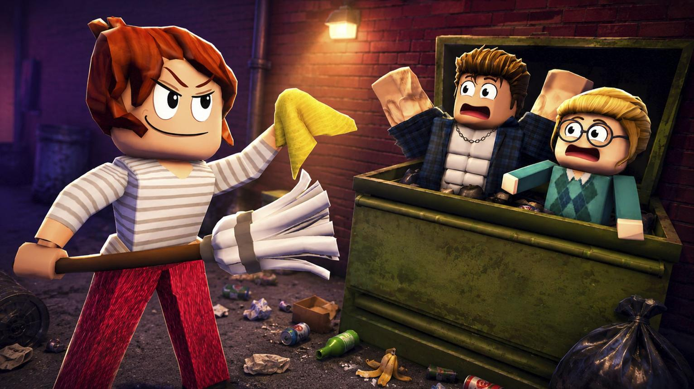

# Roblox Town Cinematic Studio

<p align="center">
  <strong>One prompt. One directed production. One finished video.</strong>
</p>

<p align="center">
  An open-source Agent Skill for planning and coordinating cinematic Roblox town, roleplay, and animated stories.
</p>

<p align="center">
  
  
  
  
</p>

---

## What is it?

**Roblox Town Cinematic Studio** is a model- and provider-independent production skill built around one canonical director: `roblox-town-director`.

It helps coordinate the work involved in making a Roblox story: developing the premise, writing the script, planning scenes and shots, assigning character voices, preparing captions, assembling available media, checking the result, and packaging the video.

It is not a standalone video editor or a one-click Roblox capture application. It is an agent skill and a set of supporting scripts, templates, references, and tests. What it can actually execute depends on the tools and permissions available in the environment running it.

## Visual direction

The project is intended for character-led Roblox stories, town settings, roleplay scenes, and cinematic action. These images are visual examples supplied with the repository; they are not evidence that the project automatically captured or rendered the scenes.

<p align="center">
  
  
</p>
<p align="center">
  
  
</p>

## What it includes

### Intelligence routing

The router selects models and tools by the capability a task needs, not by brand name alone. It defines 11 capability areas:

- Creative reasoning, storytelling, and research
- Coding, image generation, video generation, and 3D/animation
- Text-to-speech, audio processing, video editing, and quality assessment

Four routing modes are available: `AUTOMATIC`, `MANUAL`, `BUDGET`, and `RESOURCE_EFFICIENT`. The router distinguishes configured models from tools that are actually available and capabilities that have been experimentally verified.

Start with [the intelligence router](skills/roblox-town-director/references/intelligence-router.md).

### Adaptive planning

A production can be decomposed into a hierarchy:

`Film → Acts → Chapters → Sequences → Scenes → Shots → Assets`

The three execution profiles are `FRONTIER`, `BALANCED`, and `RESOURCE_EFFICIENT`. The skill adapts prompt depth and context size to the model and tools available, with a scene-level quality-control loop.

See [adaptive intelligence](skills/roblox-town-director/references/adaptive-intelligence.md) and [task decomposition](skills/roblox-town-director/references/task-decomposition.md) only if present in your local checkout; the current repository's reference set is listed below. 

### Story and cinematic direction

The directing guidance covers story structure, shot-scale variation, character blocking, environmental storytelling, lighting, continuity, editing rhythm, sound design, and the recurring **“In This Town…”** Shorts format.

A production plan must identify which method it actually needs:

1. Live gameplay staging
2. Custom Roblox animation
3. Hybrid or external production

It must not assume that a particular Roblox experience has a prop, emote, vehicle, animation, or camera control. Unverified game features need an in-game check and a fallback.

### Code-driven production

Where the relevant tools are installed and available, the project can coordinate workflows using:

- Python and FFmpeg
- Roblox Studio and Luau
- Blender and Python
- Remotion

Supporting scripts cover caption rendering, video assembly, production state, and visual quality checks. The presence of a script does not mean that every environment can run it.

### Captions and video assembly

The caption system defines **16 styles**: 15 distinct ASS/FFmpeg presets (`C01`–`C15`) and `C16` Auto Adaptive. The production scripts also support multi-scene assembly, transitions, dialogue-aware background-music ducking, black-frame checks, and scene contact sheets.

### Voice identity and continuity

Six internal voice IDs keep character assignments consistent when the selected provider changes.

| ID | Voice profile | Intended use |
|:--:|---|---|
| V01 | My Reference Voice | Creator-selected primary narrator |
| V02 | Mature Adult Male | Fathers, leaders, mentors, authority roles |
| V03 | Teenage Boy | Teen protagonists and friends |
| V04 | Mature Adult Female | Mothers, teachers, leaders, narrators |
| V05 | Teenage Girl | Teen protagonists and friends |
| V06 | Elder Storyteller | Grandparents and elder narration |

Voice rules are deliberately strict: V03 and V05 are fictional synthetic voices only, never clones of real minors. Private reference recordings and API credentials do not belong in a public repository.

The code package is currently located at `skills/roblox-town-director/scripts/voiceintelligence/`. Remote voice cloning is disabled. The independent identity verification field remains `false`; some provider adapters are contract-only or mock-tested, and live provider verification is still pending.

Provider configuration is documented in `skills/roblox-town-director/templates/voice-registry.json` and `project-voice-manifest.json`. Read the [voice provider adapter guide](skills/roblox-town-director/references/voice-provider-adapter.md) before changing provider bindings.

## Six operating modes

| Mode | Use |
|---|---|
| `IDEA` | Develop and stress-test a story concept |
| `SCRIPT` | Build the script and production plan |
| `SHOOT` | Plan and coordinate scene production |
| `POST` | Edit, assemble, and package available media |
| `REVIEW` | Check quality, continuity, and delivery |
| `FULL` | Coordinate the complete supported workflow |

## Platform guides

There is one canonical skill at [`skills/roblox-town-director/SKILL.md`](skills/roblox-town-director/SKILL.md). Cloning the repository does not automatically install it into every AI client; each platform has its own discovery and import method.

| Platform | Guide |
|---|---|
| Claude Code | [Installation guide](integrations/claude-code.md) |
| Claude App | [Installation guide](integrations/claude-app.md) |
| OpenAI Codex | [Installation guide](integrations/codex.md) |
| ChatGPT | [Usage guide](integrations/chatgpt.md) |
| Gemini CLI | [Installation guide](integrations/gemini-cli.md) |
| Google AI Studio | [Setup guide](integrations/ai-studio.md) |

These guides describe the intended integration path. Live end-to-end compatibility is not claimed unless the relevant guide explicitly records it as verified.

## Run the local recorded-voice backend

The optional local backend can import, validate, normalize, and assemble creator-supplied voice recordings without calling an external TTS API.

**Requirements**

- Python 3.9 or later
- FFmpeg and FFprobe available on `PATH`

Install FFmpeg using your platform's package manager:

```bash
# Debian / Ubuntu
sudo apt-get install ffmpeg

# macOS
brew install ffmpeg

# Windows
winget install Gyan.FFmpeg

# Android (Termux)
pkg install python ffmpeg
```

Run the backend:

```bash
python skills/roblox-town-director/scripts/voice_backend.py
```

Run the automated tests from the repository root:

```bash
python3 -m unittest discover -s tests -v
```

The recorded-voice example project is in [`examples/recorded-voice-test-project/`](examples/recorded-voice-test-project/). It includes a synthetic fixture generator, a project voice manifest, and a README describing the sample workflow. External TTS execution is not part of this local backend.

## Tests and verification

The `0.2.0-consolidated-r2` changelog records **82 passing automated tests** at release:

- 8 in `tests/test_voice_backend.py`
- 40 in `tests/test_voice_intelligence.py`
- 34 in `tests/test_v020_production.py`

Those are release-recorded results, not a claim that this README update reran the suite. The repository includes a GitHub Actions workflow at [`.github/workflows/ci.yml`](.github/workflows/ci.yml), but remote workflow execution remains unverified.

The following release gates are still pending:

- Full evaluation-suite execution
- Model-tier and capability benchmarks
- Live TTS provider verification
- Physical Roblox filming validation
- Remote GitHub Actions verification

## Known limits

- Physical Roblox gameplay capture and device control are not assumed.
- Rendering requires the relevant software, binaries, and permissions to be available.
- TTS adapters must be checked against the provider's real capabilities before use.
- No model benchmark scores, provider IDs, or live execution results should be inferred from configuration files alone.
- Unknown game mechanics and camera controls must be verified in the target experience.

A production is only `COMPLETE` when a playable output exists and passes the delivery checks defined by the skill. Otherwise, the result must be reported as `INCOMPLETE` or `FAILED`.

## Repository layout

```text
.
├── .github/workflows/ci.yml
├── assets/showcase/
├── examples/recorded-voice-test-project/
├── integrations/
├── skills/
│   └── roblox-town-director/
│       ├── references/
│       ├── templates/
│       ├── scripts/
│       │   ├── voice_backend.py
│       │   └── voiceintelligence/
│       ├── examples/
│       └── evaluations/
├── tests/
├── CHANGELOG.md
├── LICENSE
└── README.md
```

The caption evaluation samples are also present in the repository under `evalutions/captionsamples/` (the directory name is currently misspelled in the committed path).

## License

Released under the [MIT License](LICENSE).
