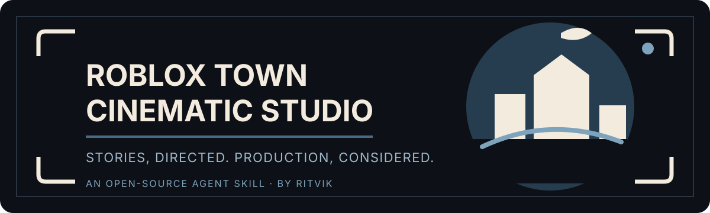

<div align="center">



# Roblox Town Cinematic Studio

**Plan the story. Direct the scenes. Build the video.**

An open-source Agent Skill for creating cinematic stories in Roblox — from the first idea to a practical production plan and post-production workflow.

[](CHANGELOG.md)
[](LICENSE)

Created and maintained by **RITVIK** · [Brand guide](assets/brand/brand-guide.md) · [Project provenance](PROVENANCE.md)

</div>

<p align="center">
  
</p>

## What is this?

**Roblox Town Cinematic Studio** gives an AI assistant a structured way to help you make Roblox town, roleplay, and animated stories.

Use it to:

- Find and improve story ideas.
- Write scripts with clear hooks, conflict, and endings.
- Design characters, scenes, shots, and camera direction.
- Plan how each scene can actually be produced.
- Keep characters, locations, props, and voices consistent.
- Prepare captions, audio, edits, and video assembly.

It is a **director and production workflow**, not a Roblox recording app or a standalone video editor. What the assistant can execute depends on the tools, software, hardware, and permissions available in your setup.

## Quick start

You only need to do three things.

### 1. Install the skill

Open a terminal with Node.js and run:

```bash
npx skills add lowlevelbtw/roblox-town-cinematic-studio \
  --skill roblox-town-director \
  -a claude-code -a codex -a antigravity
```

To install it for one agent, keep only the matching flag:

```bash
# Claude Code
npx skills add lowlevelbtw/roblox-town-cinematic-studio --skill roblox-town-director -a claude-code

# Codex
npx skills add lowlevelbtw/roblox-town-cinematic-studio --skill roblox-town-director -a codex

# Antigravity
npx skills add lowlevelbtw/roblox-town-cinematic-studio --skill roblox-town-director -a antigravity
```

Add `-g` if you want a user-level installation across projects.

**Already using another assistant?** Follow the setup guide for [Claude App](integrations/claude-app.md), [ChatGPT](integrations/chatgpt.md), [Google AI Studio](integrations/ai-studio.md), or [Gemini CLI](integrations/gemini-cli.md).

> Installing the skill does not install Roblox Studio, FFmpeg, Blender, AI services, API keys, or paid credits. Those are separate tools and services.

### 2. Give your assistant a direction

After installation, open your AI assistant and ask it to use `roblox-town-director`.

Try this first:

```text
IDEA

Give me 3 original ideas for a 60-second Roblox town Short.

For each idea, show:
- The opening hook
- The main character and their goal
- The conflict and how it escalates
- The visual moments
- The ending/payoff
- What I would need to produce it

Challenge weak ideas. Recommend the strongest one.
Keep the explanations clear and practical.
```

### 3. Choose what happens next

Once you choose an idea, tell the assistant what you want:

| If you want to… | Use this mode |
|---|---|
| Explore or improve an idea | `IDEA` |
| Write the story and plan | `SCRIPT` |
| Prepare scenes and shots | `SHOOT` |
| Work on editing and assembly | `POST` |
| Check story, visuals, and continuity | `REVIEW` |
| Coordinate the full supported workflow | `FULL` |

You can start with one mode or ask for `FULL` when you want the assistant to coordinate the whole process.

## How production works

There are **three production methods**. The assistant should choose based on the scene you want and the tools you actually have.

| Production method | What it means | Best suited to |
|---|---|---|
| **Live Gameplay Staging** | Record actions inside an existing Roblox experience. | Available avatars, locations, basic actions, and in-game props. |
| **Custom Roblox Animation** | Build scenes with custom rigs, animation, environments, and scripted effects in Roblox Studio. | Custom character movement, precise camera paths, and effects that normal gameplay cannot provide. |
| **Hybrid / External Production** | Combine Roblox footage or assets with tools such as Blender, 2D animation, compositing, or external video tools. | Motion graphics, overlays, stylized effects, and scenes that need more control. |

The skill also distinguishes two ways of creating the visuals:

- **Model Engine:** use available image, video, or audio generation models to create assets.
- **Code Engine:** use code and supported local tools to build, animate, edit, and render assets.

These are different decisions. A production method describes **where the scene comes from**; an engine describes **how its visuals are created and assembled**. The assistant can combine them when that is the practical choice.

**Important:** The assistant must check the tools and capabilities available before promising a result. If a game feature, prop, animation, or camera control has not been checked, it should be marked `UNVERIFIED` and paired with a simple test or fallback.

## From idea to finished video

A typical project follows this order:

1. **Concept** — choose a clear premise, character goal, conflict, and payoff.
2. **Script** — write the story and dialogue.
3. **Direction** — plan locations, blocking, shot sizes, camera movement, and lighting.
4. **Production** — choose the production method and prepare the scenes or assets.
5. **Post-production** — assemble footage, sound, captions, transitions, and pacing.
6. **Final review** — check continuity, audio, framing, captions, and the rendered file.

For larger projects, the skill can break the work into smaller tasks and use approval checkpoints before moving to the next stage.

## Example prompts

Copy one of these and replace the details in brackets.

### Develop a story

```text
IDEA

Create 3 story concepts about [your topic] for a
[30/60/90]-second Roblox video.

Make each concept easy to understand:
- Hook
- Character goal
- Conflict
- Escalation
- Visual moments
- Ending

Reject generic ideas and explain the strongest option.
```

### Plan the production

```text
SHOOT

Turn this approved story into a practical Roblox
production plan.

Tell me:
- Which production method each scene needs
- Which locations, characters, and props are required
- The shot list and camera direction
- What I can record with my current setup
- What needs another tool
- A simpler fallback for anything unavailable

Do not assume a game feature exists. Mark it UNVERIFIED
until it has been checked.
```

### Coordinate a complete project

```text
FULL

Help me produce a [length]-second Roblox video about
[topic].

Start with the story concept and wait for my approval.
Then prepare the script, visual direction, scene plan,
production method, audio, captions, and editing plan.

Check the tools I actually have before promising
anything that requires external software or services.
Keep each stage clear and ask only for decisions
that genuinely need my input.
```

## What is included?

| Folder | What you will find |
|---|---|
| `skills/roblox-town-director/` | The canonical skill instructions and supporting files. |
| `references/` | Storytelling, cinematic direction, production, editing, voice, and technical guidance. |
| `templates/` | Reusable production packets, outlines, task plans, and manifests. |
| `examples/` | Example projects and prompt patterns. |
| `scripts/` | Tools for voice processing, captions, production state, video assembly, and visual checks. |
| `integrations/` | Setup instructions for supported AI assistants and environments. |
| `assets/` | Brand identity and project showcase assets. |

Useful starting points:

- [Main skill instructions](skills/roblox-town-director/SKILL.md)
- [Storytelling reference](skills/roblox-town-director/references/storytelling.md)
- [Cinematic direction reference](skills/roblox-town-director/references/cinematic-direction.md)
- [Production workflow](skills/roblox-town-director/references/production-workflow.md)
- [Editing and packaging](skills/roblox-town-director/references/editing-and-packaging.md)
- [Agent Skills CLI setup](integrations/agent-skills-cli.md)

## Voice and character continuity

The skill uses six internal voice labels (`V01`–`V06`) to keep character assignments consistent. These labels are not provider voice IDs.

Remote voice cloning is disabled. The skill does not clone real minors. Provider features, permissions, and consent requirements must be checked before use.

See the [voice identity rules](skills/roblox-town-director/references/voice-identity-lock.md) and [voice provider guide](skills/roblox-town-director/references/voice-provider-adapter.md).

## Contributing

Contributions, bug reports, and documentation improvements are welcome.

Before proposing a change, explain:

1. **The problem:** What is not working or what is missing?
2. **The change:** What should be different?
3. **The check:** How can someone verify the change?

See [CONTRIBUTING.md](CONTRIBUTING.md) before opening a contribution. For security issues, follow [SECURITY.md](SECURITY.md).

## Project identity

The repository includes the [product icon](assets/brand/icon.svg), [wordmark](assets/brand/logo.svg), [skill badge](assets/brand/skill-badge.svg), and [brand guide](assets/brand/brand-guide.md).

Creator attribution and project history are documented in [PROVENANCE.md](PROVENANCE.md).

## License

Roblox Town Cinematic Studio is released under the [MIT License](LICENSE).

---

<div align="center">

**Roblox Town Cinematic Studio**

Stories, directed. Production, considered.

Created and maintained by **RITVIK**

</div>
