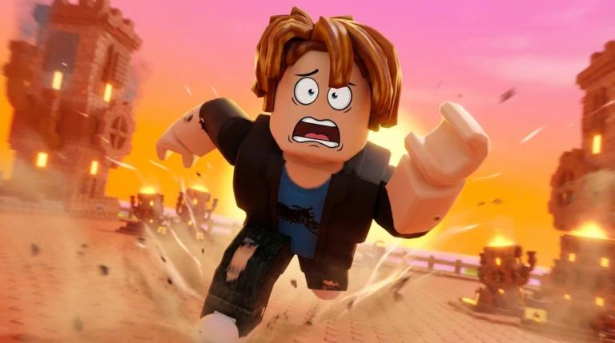

# Roblox Town Cinematic Studio

<p align="center">
  <strong>One prompt. One directed production. One finished video.</strong>
</p>

<p align="center">
  An open-source Agent Skill for planning and coordinating cinematic Roblox town, roleplay, and animated stories.
</p>

<p align="center">
  
  
  
  
</p>

---

## Quick install

Install the canonical `roblox-town-director` skill into Claude Code, Codex, and Antigravity with the community Skills CLI:

```bash
npx skills add lowlevelbtw/roblox-town-cinematic-studio \
  --skill roblox-town-director \
  -a claude-code -a codex -a antigravity
```

Add `-g` for a user-level installation across projects. To install into only one agent, keep just its matching `-a` flag. The CLI may ask you to choose an installation method; symlinks keep one canonical copy where supported, while copies are useful where symlinks are unavailable.

Check or update the installation later:

```bash
npx skills list
npx skills check
npx skills update roblox-town-director
```

The Skills CLI installs the Agent Skill files; it does **not** install Roblox Studio, FFmpeg, Blender, video-generation services, API credentials, or other production dependencies. Google AI Studio does not use this local skill installer; follow the [AI Studio setup guide](integrations/ai-studio.md). See the [cross-agent installer guide](integrations/agent-skills-cli.md) for details and limitations.

## Quickstart

### Step 1 — Get the skill

Clone the repository:

```bash
git clone https://github.com/lowlevelbtw/roblox-town-cinematic-studio.git
cd roblox-town-cinematic-studio
```

Or install the canonical skill directly with the Skills CLI using the command above.

### Step 2 — Confirm the agent can read it

Ask your agent to inspect `skills/roblox-town-director/SKILL.md` and the references relevant to your task. If you installed through the CLI, invoke `roblox-town-director` or ask the agent to use the installed skill. Do not assume that skill installation also installs production software or grants access to external models.

### Step 3 — Try a first project

Start with a focused concept request:

```text
IDEA

Develop three original concepts for a 60-second Roblox town Short.

Evaluate each for:
- Opening hook
- Character goal and conflict
- Escalation and visual storytelling
- Ending payoff
- Production feasibility

Challenge weak concepts instead of praising them automatically.
Recommend the strongest concept and explain why.
```

When ready, move to `SCRIPT`, `SHOOT`, `POST`, `REVIEW`, or `FULL`. The six modes are documented below. For a complete project, `FULL` coordinates the supported workflow while preserving the skill's capability checks and approval boundaries.

## What is it?

**Roblox Town Cinematic Studio** is a model- and provider-independent production skill built around one canonical director: `roblox-town-director`.

It helps coordinate the work involved in making a Roblox story: developing the premise, writing the script, planning scenes and shots, assigning character voices, preparing captions, assembling available media, checking the result, and packaging the video.

It is not a standalone video editor or a one-click Roblox capture application. It is an agent skill and a set of supporting scripts, templates, references, and tests. What it can actually execute depends on the tools and permissions available in the environment running it.

## Visual direction

The project is intended for character-led Roblox stories, town settings, roleplay scenes, and cinematic action. These images are visual examples supplied with the repository; they are not evidence that the project automatically captured or rendered the scenes.

<p align="center">
  
  
</p>
<p align="center">
  
  
</p>

## What it includes

### Intelligence routing

The router selects models and tools by the capability a task needs, not by brand name alone. It defines 11 capability areas:

- Creative reasoning, storytelling, and research
- Coding, image generation, video generation, and 3D/animation
- Text-to-speech, audio processing, video editing, and quality assessment

Four routing modes are available: `AUTOMATIC`, `MANUAL`, `BUDGET`, and `RESOURCE_EFFICIENT`. The router distinguishes configured models from tools that are actually available and capabilities that have been experimentally verified.

Start with [the intelligence router](skills/roblox-town-director/references/intelligence-router.md).

### Adaptive planning

A production can be decomposed into a hierarchy:

`Film → Acts → Chapters → Sequences → Scenes → Shots → Assets`

The three execution profiles are `FRONTIER`, `BALANCED`, and `RESOURCE_EFFICIENT`. The skill adapts prompt depth and context size to the model and tools available, with a scene-level quality-control loop.

See [adaptive intelligence](skills/roblox-town-director/references/adaptive-intelligence.md) and [task decomposition](skills/roblox-town-director/references/task-decomposition.md).

### Story and cinematic direction

The directing guidance covers story structure, shot-scale variation, character blocking, environmental storytelling, lighting, continuity, editing rhythm, sound design, and the recurring **“In This Town…”** Shorts format.

A production plan must identify which method it actually needs:

1. Live gameplay staging
2. Custom Roblox animation
3. Hybrid or external production

It must not assume that a particular Roblox experience has a prop, emote, vehicle, animation, or camera control. Unverified game features need an in-game check and a fallback.

### Code-driven production

Where the relevant tools are installed and available, the project can coordinate workflows using:

- Python and FFmpeg
- Roblox Studio and Luau
- Blender and Python
- Remotion

Supporting scripts cover caption rendering, video assembly, production state, and visual quality checks. The presence of a script does not mean that every environment can run it.

### Captions and video assembly

The caption system defines **16 styles**: 15 distinct ASS/FFmpeg presets (`C01`–`C15`) and `C16` Auto Adaptive. The production scripts also support multi-scene assembly, transitions, dialogue-aware background-music ducking, black-frame checks, and scene contact sheets.

### Voice identity and continuity

Six internal voice IDs keep character assignments consistent when the selected provider changes.

| ID | Voice profile | Intended use |
|:--:|---|---|
| V01 | My Reference Voice | Creator-selected primary narrator |
| V02 | Mature Adult Male | Fathers, leaders, mentors, authority roles |
| V03 | Teenage Boy | Teen protagonists and friends |
| V04 | Mature Adult Female | Mothers, teachers, leaders, narrators |
| V05 | Teenage Girl | Teen protagonists and friends |
| V06 | Elder Storyteller | Grandparents and elder narration |

Voice rules are deliberately strict: V03 and V05 are fictional synthetic voices only, never clones of real minors. Private reference recordings and API credentials do not belong in a public repository.

The code package is currently located at `skills/roblox-town-director/scripts/voiceintelligence/`. Remote voice cloning is disabled. The independent identity verification field remains `false`; some provider adapters are contract-only or mock-tested, and live provider verification is still pending.

Provider configuration is documented in `skills/roblox-town-director/templates/voice-registry.json` and `project-voice-manifest.json`. Read the [voice provider adapter guide](skills/roblox-town-director/references/voice-provider-adapter.md) before changing provider bindings.

## Quality control

Every substantial project is reviewed through two independent gates. A strong story is not automatically a feasible production, and technically feasible production is not automatically a compelling story.

### Gate A — Story and creative quality

- Opening hook and audience interest
- Character motivation and clarity of the central goal
- Conflict, escalation, and payoff
- Visual storytelling rather than exposition
- Emotional or comedic effect appropriate to the intended genre

### Gate B — Production feasibility

- Actually available tools, models, permissions, and hardware
- Production-method and engine fit
- Scene complexity, cast, camera, locations, and asset requirements
- Runtime, rendering, storage, and other technical constraints
- A practical lower-resource fallback

Each gate receives one verdict:

- `STRONG` — meets the requirements without a material unresolved weakness.
- `NEEDS WORK` — viable after specific revisions or a smaller scope.
- `FAIL` — the current concept or production plan should not proceed unchanged.

Report both verdicts separately with concise evidence and next actions. Never let a strong result in one gate conceal a failure in the other. Apply this review in `IDEA`, `SCRIPT`, `SHOOT`, and `FULL` at the level appropriate to the request; run the Stage L delivery check before calling a production complete.

## Six operating modes

| Mode | Use |
|---|---|
| `IDEA` | Develop and stress-test a story concept |
| `SCRIPT` | Build the script and production plan |
| `SHOOT` | Plan and coordinate scene production |
| `POST` | Edit, assemble, and package available media |
| `REVIEW` | Check quality, continuity, and delivery |
| `FULL` | Coordinate the complete supported workflow |

## Platform guides

There is one canonical skill at [`skills/roblox-town-director/SKILL.md`](skills/roblox-town-director/SKILL.md). Cloning the repository does not automatically install it into every AI client; each platform has its own discovery and import method.

| Platform | Guide |
|---|---|
| Claude Code | [Installation guide](integrations/claude-code.md) |
| Claude App | [Installation guide](integrations/claude-app.md) |
| OpenAI Codex | [Installation guide](integrations/codex.md) |
| ChatGPT | [Usage guide](integrations/chatgpt.md) |
| Gemini CLI | [Installation guide](integrations/gemini-cli.md) |
| Google AI Studio | [Setup guide](integrations/ai-studio.md) |
| Google Antigravity | [Installation guide](integrations/antigravity.md) |
| Agent Skills CLI (Claude Code, Codex, Antigravity) | [Cross-agent installer guide](integrations/agent-skills-cli.md) |

These guides describe the intended integration path. Live end-to-end compatibility is not claimed unless the relevant guide explicitly records it as verified.

## Run the local recorded-voice backend

The optional local backend can import, validate, normalize, and assemble creator-supplied voice recordings without calling an external TTS API.

**Requirements**

- Python 3.9 or later
- FFmpeg and FFprobe available on `PATH`

Install FFmpeg using your platform's package manager:

```bash
# Debian / Ubuntu
sudo apt-get install ffmpeg

# macOS
brew install ffmpeg

# Windows
winget install Gyan.FFmpeg

# Android (Termux)
pkg install python ffmpeg
```

Run the backend:

```bash
python skills/roblox-town-director/scripts/voice_backend.py
```

Run the automated tests from the repository root:

```bash
python3 -m unittest discover -s tests -v
```

The recorded-voice example project is in [`examples/recorded-voice-test-project/README.md`](examples/recorded-voice-test-project/README.md). It includes a synthetic fixture generator, a project voice manifest, and a README describing the sample workflow. External TTS execution is not part of this local backend.

## Evaluation and validation

The repository includes **14 evaluation scenarios** plus separate model-tier and voice-intelligence acceptance suites. These are test specifications, not proof that the complete skill has passed live evaluation.

The 14-scenario suite covers:
- Creative judgment and story development
- Visual direction and cinematic staging
- Production-method classification and feasibility
- Hardware independence and practical alternatives
- Technical honesty when tools or providers are unavailable
- Six-voice identity, continuity, provider migration, and minor-safety boundaries

**Current status:** Scenarios 01–10 and 12–14 are `NOT RUN`. Scenario 11 has structural/schema checks recorded as validated, but live TTS generation remains `BLOCKED` without a connected provider. Physical device filming validation remains `NOT RUN`. Model-tier benchmarks remain `NOT RUN`; do not infer scores from configuration or mock tests.

See the [14-scenario evaluation suite](skills/roblox-town-director/evaluations/test-suite.md), [model-tier benchmark suite](skills/roblox-town-director/evaluations/model-tier-benchmark.md), and [voice-intelligence acceptance criteria](skills/roblox-town-director/evaluations/voice-intelligence-acceptance.md).

## Tests and verification

The `0.2.0` release records **82 passing automated tests** at release:

- 8 in `tests/test_voice_backend.py`
- 40 in `tests/test_voice_intelligence.py`
- 34 in `tests/test_v020_production.py`

Those are release-recorded results, not a claim that this README update reran the suite. No GitHub Actions workflow is currently present in the published repository, so remote CI execution has not been verified.

The following validation gates remain pending:

- Full evaluation-suite execution
- Model-tier and capability benchmarks
- Live TTS provider verification
- Physical Roblox filming validation

## Roadmap

### Implemented in the 0.2.0 prototype

- Canonical Agent Skill architecture with six operating modes
- Three production methods and capability-based production classification
- Intelligence routing and adaptive task decomposition
- Six internal voice identities with continuity rules and consent boundaries
- Sixteen caption styles, including adaptive selection
- Local recorded-voice processing, multi-scene assembly, visual QC, recovery state, and a final delivery gate
- Model Engine, Code Engine, and hybrid execution guidance
- Two-gate creative-quality and production-feasibility review

### Next validation milestones

- Execute all 14 evaluation scenarios and publish observed results
- Run repeatable model-tier and capability benchmarks
- Verify live provider integrations only where credentials, permissions, and spending approval are available
- Validate capture workflows on real Roblox experiences and target devices
- Expand automated regression coverage and maintain installation guides as agent support changes

Roadmap items are goals, not promises of delivery dates. A feature is not considered validated until its stated test has actually been run and its evidence recorded.

## Known limits

- Physical Roblox gameplay capture and device control are not assumed.
- Rendering requires the relevant software, binaries, and permissions to be available.
- TTS adapters must be checked against the provider's real capabilities before use.
- No model benchmark scores, provider IDs, or live execution results should be inferred from configuration files alone.
- Unknown game mechanics and camera controls must be verified in the target experience.

A production is only `COMPLETE` when a playable output exists and passes the delivery checks defined by the skill. Otherwise, the result must be reported as `INCOMPLETE` or `FAILED`.

## Repository layout

```text
.
├── assets/showcase/
├── evalutions/captionsamples/  # existing path spelling retained for compatibility
├── examples/recorded-voice-test-project/
│   ├── README.md
│   ├── generate_synthetic_fixtures.py
│   └── project-voice-manifest.json
├── integrations/
│   ├── agent-skills-cli.md
│   ├── ai-studio.md
│   ├── antigravity.md
│   ├── chatgpt.md
│   ├── claude-app.md
│   ├── claude-code.md
│   ├── codex.md
│   └── gemini-cli.md
├── skills/
│   └── roblox-town-director/
│       ├── references/
│       ├── templates/
│       ├── scripts/
│       │   ├── voice_backend.py
│       │   └── voiceintelligence/
│       ├── examples/
│       └── evaluations/
├── tests/
├── CHANGELOG.md
├── LICENSE
└── README.md
```

The caption evaluation sample directory currently uses the legacy path `evalutions/captionsamples/`; the spelling is retained here to match the committed repository path.

## Contributing

Contributions, bug reports, documentation improvements, evaluation cases, and carefully scoped production features are welcome.

When proposing a change, include:

1. **Problem:** what concrete user or production problem does it solve?
2. **Change:** what should be modified, and why is this the right layer (skill instructions, reference, template, script, or test)?
3. **Validation:** how can the change be tested, and what evidence would demonstrate success?

Before submitting:
- Keep the canonical skill and supporting references consistent.
- Preserve capability honesty: distinguish implemented, configured, mocked, blocked, and live-verified behaviour.
- Add or update tests for code changes and evaluation scenarios for meaningful behavioural changes.
- Run the relevant checks and report exact commands and results. Do not label unrun tests as passing.
- Never commit API keys, private recordings, or other secrets.

Run the Python test suite from the repository root:

```bash
python3 -m unittest discover -s tests -v
```

## License

Released under the [MIT License](LICENSE).
